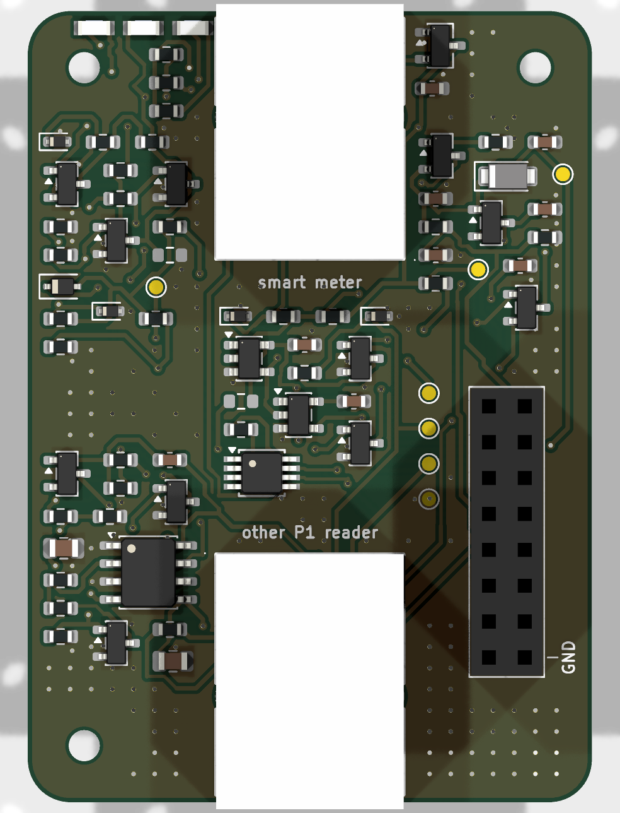
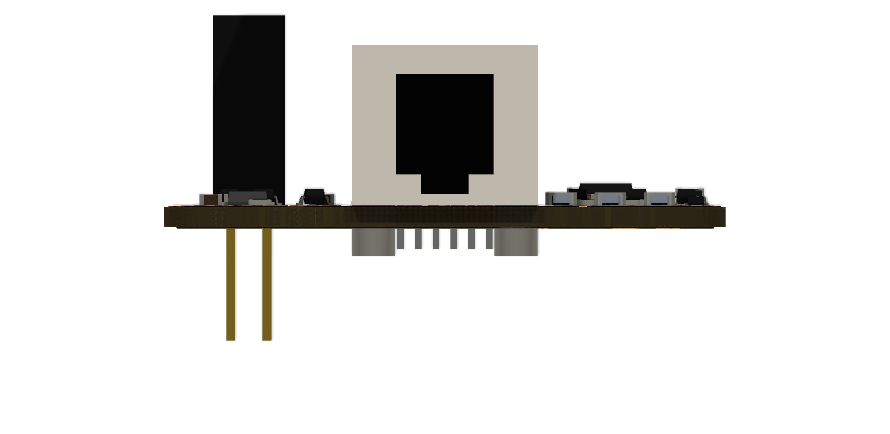

# NeedForHeat P1-BASE hardware <!-- omit in toc -->

This repository contains the open hardware design files for the NeedForHeat P1-BASE, an extension module (BASE) for the back of an [M5Stack CoreInk](https://docs.m5stack.com/en/core/coreink). With it, the CoreInk reads [smart meters that adhere to the Dutch Smart Meter Requirements](https://github.com/energiegedrag-nl/dsmr-info) via the [P1 port](https://nl.wikipedia.org/wiki/P1-poort), while an existing P1 reader of the household keeps working.

> **Own deployment.** This repository is maintained by [energiegedrag-nl](https://github.com/energiegedrag-nl) and deployed under `energiegedrag.nl`. To run your own instance, replace `energiegedrag-nl` by your GitHub organisation and `energiegedrag.nl` by your domain (hosts used: `api.<domain>`, `manuals.<domain>`), consistently in configuration and build settings.

> **Version 3.0 (November 2026) is a design that has not been built or tested yet.** The previous version 2.7 (June 2024, with DIP switches) is available under the git tag `v2.7`. See [docs/design-v3.md](docs/design-v3.md) for the design and the list of points to verify on the first prototype.

*Top edge: smart-meter socket `J2` with its green LED, which shows through a window in the top wall of the tray. The lower socket `J3` has its own green LED in the bottom wall.*

## Table of contents <!-- omit in toc -->
- [General info](#general-info)
- [Producing](#producing)
  - [Printed Circuit Board](#printed-circuit-board)
  - [Enclosure](#enclosure)
- [Deploying](#deploying)
  - [Cost](#cost)
  - [Connecting](#connecting)
  - [Indicators](#indicators)
- [Developing](#developing)
- [Features](#features)
- [Status](#status)
- [License](#license)
- [Citation](#citation)
- [Credits](#credits)

## General info

The P1-BASE plugs into the 2x8 MI-BUS socket on the back of the CoreInk. The upper RJ12 socket (`J2`, *smart meter*) connects to the P1 port of the smart meter; the lower RJ12 socket (`J3`, *other P1 reader*) takes the cable of an existing P1 reader, as if it were connected to the meter itself.

In short (details in [docs/design-v3.md](docs/design-v3.md)):

* **Meter input** with a 1 kΩ pull-up and a Schmitt trigger, as in the v2.7 front end that read Landis+Gyr E350/E360 meters in the lab.
* **Active splitter**, powered by the meter: an existing reader keeps getting data when the CoreInk is off, asleep or crashed.
* **Data request** without DIP switches: the CoreInk (G26) and the existing reader can both request data; firmware can see whether the reader requests (G34).
* **Power from the P1 port**: on DSMR 5 meters the BASE can charge the CoreInk battery at 60 or 120 mA, switched by firmware and with a soft start that stays below the meter's fold-back limit.
* **Robust installation**: a crossed RJ12 cable or a cable in the wrong socket does no harm, and the firmware can tell which mistake was made.

The firmware is [needforheat-p1-reader-firmware](https://github.com/energiegedrag-nl/needforheat-p1-reader-firmware) (PlatformIO environment `M5STACK_COREINK_P1BASE_V3`).

## Producing

### Printed Circuit Board

The folder [pcb/jlcpcb](./pcb/jlcpcb) contains the files to have the PCB manufactured *and assembled* by [JLCPCB](https://jlcpcb.com); no soldering is needed:

1. Upload [`GERBER-needforheat-p1-base-hardware.zip`](./pcb/jlcpcb/GERBER-needforheat-p1-base-hardware.zip) on the [JLCPCB quote page](https://cart.jlcpcb.com/quote). Defaults are fine (2 layers, 1.6 mm).
2. Select *PCB Assembly*, top side, and upload [`BOM-needforheat-p1-base-hardware.csv`](./pcb/jlcpcb/BOM-needforheat-p1-base-hardware.csv) and [`CPL-needforheat-p1-base-hardware.csv`](./pcb/jlcpcb/CPL-needforheat-p1-base-hardware.csv).
3. The three through-hole parts (two RJ12 sockets, the 2x8 stacking header) are soldered by JLCPCB as well; accept the through-hole assembly option.
4. `R6` and `R15` are intentionally not fitted (see [assembly variants](docs/design-v3.md#8-production)).

Schematic and layout printouts: [docs/needforheat-p1-base-hardware-sch.pdf](docs/needforheat-p1-base-hardware-sch.pdf) and [docs/needforheat-p1-base-hardware-pcb.pdf](docs/needforheat-p1-base-hardware-pcb.pdf).

### Enclosure

The folder [enclosure](./enclosure) contains a parametric enclosure (CadQuery script) and exported STEP/STL files in [enclosure/fabrication](./enclosure/fabrication): a tray (*kuip*) that holds the PCB and a lid that clicks onto it (snap fit, no screws). The outside is exactly the CoreInk's outline (40 x 56 mm), so any BASE that fits a bare CoreInk also fits behind the P1-BASE. Four posts with crush ribs centre the module in the CoreInk's LEGO-compatible holes; the lid repeats those holes as LEGO Technic holes and has the bus socket just below its surface (0.3 mm), like the CoreInk's back; feet under the lid's corners hold the PCB down. Each socket's LED shows through a window in the wall next to it; an arrow on the lid points to the meter edge. Each module fits a letterbox parcel on its own (at most 27 mm thick). Print with PETG or let a 3D printing service make them (SLA resin or MJF nylon).

## Deploying

### Cost

Indicative, November 2026, excluding VAT and shipping. JLCPCB quotes (LeadFree HASL, top side, no panelisation;
5 pieces on 17 November after the design review, the rest on 16 November 2026; the review changed only resistor
values and J1's drill, which hardly changes the price) for the same quantities as the
[BatteryBASE](https://github.com/energiegedrag-nl/needforheat-battery-base-hardware#cost). Everything is assembled
by JLCPCB, the through-hole parts included: the quotes contain the hand-soldering fee (€ 3.27 per order) and the
per-joint manual assembly of the RJ12 jacks. The stacking header J1 (Samtec ESQ-108-24-G-D, C21241050) is not in
JLCPCB's stock: it is bought through JLCPCB's *Global Sourcing* into the account's parts library (9–15 days or more;
the prototype's seven arrive on 8 December 2026) and then assembled by JLCPCB (Samtec rates it for lead wave soldering only, so the order asks for hand
soldering with the pins kept free of solder; Economic and Standard PCBA). The J1 column adds its Global Sourcing price (€ 6.28 each, the price of the prototype's order),
its extended-part loading fee (€ 3.16 per order) and the soldering of its 16 joints (about € 0.26 per board,
JLCPCB's [per-joint rate](https://jlcpcb.com/help/article/PCB-assembly-faqs) of $ 0.0173); to be confirmed by the
quote with J1 once it is in the parts library.

| Quantity | PCBA type | PCB + PCBA without J1 | J1 (part, fee, soldering) | Per board | Enclosure (tray, lid) per set |
|---:|---|---:|---:|---:|---:|
| 5 | Economic | € 59.50 | € 35.84 | € 19.07 | $ 3.32 |
| 10 | Economic | € 79.26 | € 68.52 | € 14.78 | $ 3.32 |
| 30 | Economic | € 157.92 | € 199.24 | € 11.91 | $ 3.32 |
| 100 | Standard (Economic not offered) | € 274.37 + U5 € 185.94 | € 656.76 | € 11.17 | $ 3.32 |

J1 is the most expensive part by far. For larger series it is worth buying it cheaper: Samtec lists $ 4.10 each at
25 and $ 3.39 at 100, and JLCPCB's pre-order price is € 3.67 when a pre-order goes through (the prototype's
pre-order of 15 November 2026 was cancelled and refunded). Global Sourcing has to be ordered at least 10 pieces at a
time in the parts cart (the prototype's order of seven went through at checkout).

At 100 pieces JLCPCB had only 62 PCA9633 LED dimmers (U5) in stock: the € 274.37 is without U5, which adds about
€ 1.86 per board at JLCPCB's part price once it is in stock again. The PCA9633 is also the most expensive part at
small quantities (€ 2.78 at 5, € 2.36 at 10). Enclosure: MJF nylon prints (PA12, dyed black), which JLC3DP prices
per piece, so the price per set does not depend on the quantity (17 November 2026: tray $ 1.62, lid $ 1.70; the
prototype order adds a second lid with a firmer snap fit, $ 1.70). Shipping to the Netherlands adds about € 20–25 per
order.

| Item | Approx. price |
|---|---:|
| P1-BASE PCB, assembled (JLCPCB), J1 included | € 11–19 (see above) |
| Enclosure (3D printed, MJF nylon) | € 3 |
| M5Stack CoreInk | € 36 |
| RJ12 cable 6P6C, straight (1:1), ≤ 0.5 m | € 3–6 |
| USB power adapter (only for DSMR 2/3 meters) | € 10–15 |

### Connecting

The CoreInk and the P1-BASE are shipped separately (each fits a letterbox parcel) and clicked together at home.

1. Hold the CoreInk with its screen facing you and the HAT connector (top edge) up. Push the P1-BASE onto its back so that the *smart meter* socket is at the top (the arrow on the lid points up); it only fits this way round.
2. Unplug an existing P1 reader (if any) from the smart meter.
3. Plug the supplied **straight (1:1)** RJ12 cable into the *smart meter* socket and into the P1 port of the smart meter. Do not use a telephone cable: those are crossed. A crossed cable does no damage, but nothing works; the screen will say so.
4. Plug the existing P1 reader into the lower *other P1 reader* socket.

With a DSMR 2 or 3 meter (no power on the P1 port), also connect the USB power adapter to the CoreInk.

### Indicators

Each socket has a green light next to it: **it blinks when data goes over that cable.**

| Green light next to | Blinks | Stays dark (or lights steadily): check |
|---|---|---|
| *smart meter* socket (top) | the meter sends data | the cable to the meter; whether the meter's P1 port is enabled (with no cable, or a meter that is not asked for data, it can light steadily) |
| *other P1 reader* socket (bottom) | the existing P1 reader asks for data and gets it | whether a reader is plugged in and powered; its cable |

Charging the CoreInk battery from the P1 port (DSMR 5 meters) is shown on the screen.

Firmware can dim both LEDs together or switch them off (I²C LED driver, see [LED dimmer](docs/design-v3.md#47-led-dimmer)); the hardware still decides when each LED is on. The driver is powered by the meter, so the setting survives while the CoreInk sleeps or is off; until firmware sets it (and after the meter's power was lost), the LEDs light at full brightness.

## Developing

You need [KiCad 10](https://www.kicad.org/download/) to change the design; the KiCad files are in [pcb](./pcb).

The schematic and the board are generated by scripts in [tools](./tools), so that the netlist, the placement and the documentation stay consistent:

* `python tools/gen_schematic.py` writes the schematic and the custom symbol library from the circuit description in the script.
* `"<KiCad>/bin/python.exe" tools/gen_pcb.py` builds the board from the schematic netlist, places the parts and routes the board with [Freerouting](https://github.com/freerouting/freerouting) (Java 25 needed).
* `python tools/sim/run_sims.py` runs SPICE checks with the ngspice library that ships with KiCad and writes [docs/simulation](docs/simulation).
* `python tools/export_fab.py` writes the JLCPCB files and the PDF printouts.
* 3D models in `pcb/p1base.3dshapes`: J1 is Samtec's own model of the ESQ-108-24-G-D (downloaded from the
  [product page](https://www.samtec.com/products/esq-108-24-g-d), provided "as is"; placed by
  `python tools/import_samtec_j1.py <esq-108-24-g-d.stp>`). EVERCOM publishes no 3D model of the RJ12 jack
  5301-6P6C, so `python tools/gen_3d_models.py` builds an approximate one from its drawing (5301-660XXX rev. A).

You may also edit the KiCad files by hand; then stop using the generators or port your changes into them.

## Features

Ready (in the design, not yet verified on hardware):

- [x] Active P1 splitter powered by the meter, open-drain output as DSMR prescribes.
- [x] Data request by firmware and by the existing reader (hardware OR); read-back of the reader's request.
- [x] Charging the CoreInk battery from DSMR 5 meters at 60/120 mA with soft start.
- [x] Protection against crossed cables and ESD; meter voltage measurement for diagnosis.
- [x] A green LED next to each socket that blinks when data goes over that cable; dimmable by firmware (one common level); test points.
- [x] All parts on the top side; full assembly by JLCPCB.
- [x] Enclosure flush with the CoreInk outline, so other CoreInk BASEs still stack behind it; snap-fit lid with LEGO Technic holes.

To-do:

- [ ] Build and test a first prototype (see [the list of points to verify](docs/design-v3.md#10-open-points-to-verify)), including Landis+Gyr E360 meters and common P1 readers on the second socket.

## Status

Project is: _in progress_ (v3.0 design; v2.7 built and lab-tested in 2024).

## License

The hardware designs in this repository are available under the [CERN-OHL-P v2 license](./LICENSE).
Copyright 2024 [Research group Energy Transition, Windesheim University of Applied Sciences](https://windesheim.nl/energietransitie) (up to v2.7); copyright 2026 Henri ter Hofte (v3.0).

## Citation

If you use this repository in your research or work, please cite the following pre-print, which describes the overall NeedForHeat DataGear system of which this repository is a part:

> Ter Hofte, H., & van Ravenzwaaij, N. (2025). *NeedForHeat DataGear: An Open Monitoring System to Accelerate the Residential Heating Transition*. arXiv preprint arXiv:2509.06927. https://doi.org/10.48550/arXiv.2509.06927

**Note:** This is a pre-print submitted on 8 Sep 2025 and has not yet been peer-reviewed. For the full paper, see [https://arxiv.org/abs/2509.06927](https://arxiv.org/abs/2509.06927).

## Credits

Version 3.0:
* Henri ter Hofte · [@henriterhofte](https://github.com/henriterhofte)

Version 2.7 and earlier, made at the Research group Energy Transition, Windesheim University of Applied Sciences, as a collaborative effort of:
* Rick de Graaf · [@277r](https://github.com/277r)
* Gerwin ten Have · [@GerwintenHave](https://github.com/GerwintenHave)

with product owners:
* Henri ter Hofte · [@henriterhofte](https://github.com/henriterhofte)
* Marco Winkelman · [@MarcoW71](https://github.com/MarcoW71)

We use and gratefully acknowledge the efforts of the makers of:
* [Twomes P1 Gateway Hardware](https://github.com/energiegedrag-nl/twomes-p1-gateway-hardware), by Research group Energy Transition at Windesheim University of Applied Sciences, licensed under Apache 2.0
* [KiCad Libraries](https://kicad.github.io/), by the KiCad Development Team, licensed under [an adapted version of the CC-BY-SA 4.0 License](https://www.kicad.org/libraries/license/)
* [Freerouting](https://github.com/freerouting/freerouting), licensed under GPL-3.0 (used as a tool; no code included)
* [ngspice](https://ngspice.sourceforge.io/) and [CadQuery](https://github.com/CadQuery/cadquery) (used as tools)
* The mechanical data of the [M5Stack CoreInk](https://github.com/m5stack/M5_Hardware), by M5Stack

### AI assistance

Since November 2026, parts of this repository (the v3.0 design, its generators and documentation) have been made with [Claude Code](https://claude.com/claude-code) (Anthropic), under the author's direction and review. Commits made this way carry a `Co-Authored-By: Claude …` trailer. The author remains responsible for all content.
