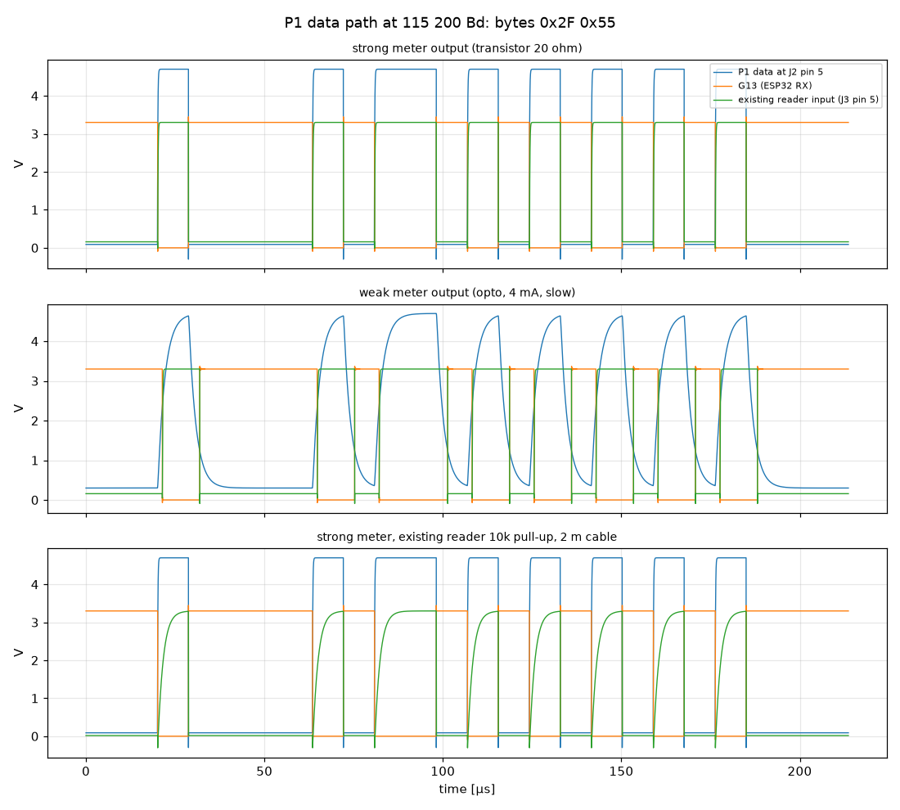
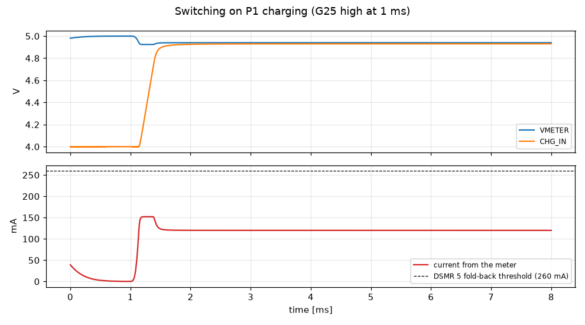
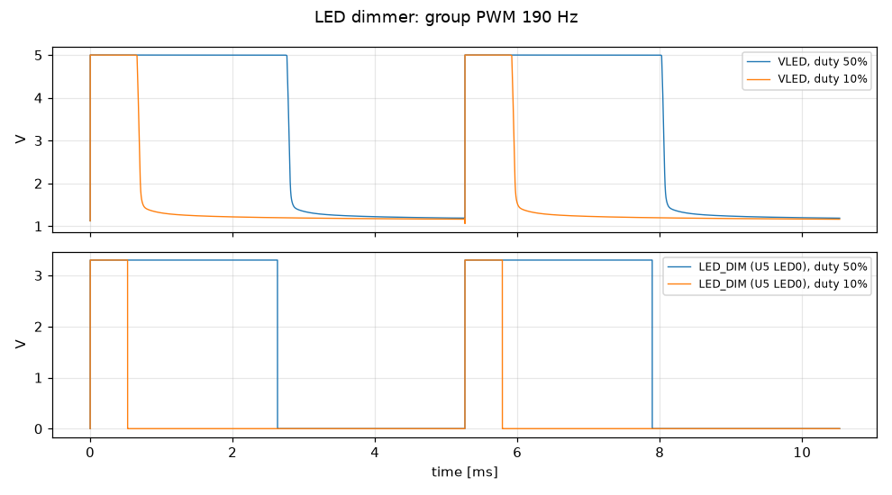

# Simulation results

Generated by `tools/sim/run_sims.py` with ngspice (KiCad 10). Generic models: check levels and margins, not exact waveforms.

## 1. Data path at 115 200 Bd

| Case | Lowest level at J2 pin 5 [V] | G13 high [V] | Max bit-width error G13 [%] | Max bit-width error reader [%] |
|---|---:|---:|---:|---:|
| strong meter output (transistor 20 ohm) | -0.30 | 3.45 | 0.56 | 1.5 |
| weak meter output (opto, 4 mA, slow) | 0.30 | 3.37 | 21.2 | 20.31 |
| strong meter, existing reader 10k pull-up, 2 m cable | -0.30 | 3.45 | 0.56 | 14.27 |

## 2. Data request levels (DC)

DSMR: the request must be ≥ 4.0 V to make the meter send. The existing reader is modelled as 5 V behind 1 kΩ (a weak request output) and the meter's request input as 1 mA at 5 V (4.7 kΩ).

| Case | Request at meter (J2 pin 2) [V] | ≥ 4.0 V? | G34 [V] | G36 [V] |
|---|---:|:---:|---:|---:|
| DSMR 5, CoreInk requests (G26 high) | 4.73 | yes | 0.00 | 2.02 |
| DSMR 5, existing reader requests | 4.73 | yes | 2.79 | 2.02 |
| DSMR 5, both request | 4.73 | yes | 2.79 | 2.02 |
| DSMR 5, nobody requests | 0.00 | – (idle) | 0.00 | 2.02 |
| DSMR 2/3, CoreInk on, requests | 4.71 | yes | 0.00 | 0.00 |
| DSMR 2/3, CoreInk off, reader requests | 3.49 | **no** (see note) | 2.18 | 0.00 |
| DSMR 5, reader requests with weak 4.5 V output (1 k) | 4.73 | yes | 2.51 | 2.02 |

Note: with a DSMR 2/3 meter and the CoreInk off the BASE has no supply, so the reader's request only reaches the meter through D7 (passive path). With the weak 1 kΩ reader modelled here that gives ≈ 3.5 V, below 4.0 V; a reader with a stiff 5 V output gives ≈ 4.6 V. With the CoreInk on, the active path (Q5 → Q3) restores the full level. Known limitation, see design-v3.md § 4.4 (D7); to be measured with real readers and DSMR 2/3 meters (design-v3.md § 10, items 6 and 7).

D7 leakage with no reader on J3 and our request high (reverse biased D7, about 4.7 V): the leakage flows into EXT_REQ, held low only by R13+R14 and R18+R19. If EXT_REQ_G reaches Q5's threshold (2N7002: 1.0 to 2.5 V), Q5 keeps Q3 on after G26 goes low and the request latches. R13 = 2.2 kΩ and R14 = 20 kΩ keep EXT_REQ_G under 1.0 V up to about 60 µA (a 1N5819WS-class Schottky leaks a few µA at 25 °C, doubling about every 10 °C). Test on the prototype: no reader, pulse G26, warm D7 to about 60 °C, check that TP4 (METER_REQ) drops.

| D7 leakage [µA] | EXT_REQ_G, R13 2.2k / R14 20k [V] | old values R13 10k / R14 100k [V] |
|---:|---:|---:|
| 10 | 0.17 | 0.51 |
| 20 | 0.34 | 1.02 |
| 40 | 0.67 | 2.04 |
| 80 | 1.34 | 4.09 |

## 3. Switching on P1 charging

Peak current drawn from the meter: **152 mA** (DSMR 5 fold-back starts at 260 mA; the steady state is the 120 mA charge current plus the rest of the board).

## 4. Crossed (1-to-6) cable

Meter powered, cable crossed, CoreInk on battery.

| Node | Value |
|---|---:|
| vmeter | 0.033 |
| metreq | -4.995 |
| p1data | 3.071 |
| g36 | 0.014 |
| extreq | -4.918 |
| I_meter_mA | 1.774 |

## 5. LED dimmer

U5 (PCA9633) LED0 at the 190 Hz group PWM switches VLED through Q10 and Q9 (design-v3.md § 4.7). Without U5 (variant without dimming) LED_DIM sits at 3.3 V through R34: the 100 % row.

| Group PWM duty | Average current LED1 (green) [mA] | Fraction of time VLED > 2.5 V | VLED rise time to 4.5 V [µs] |
|---:|---:|---:|---:|
| 100% | 1.430 | 1.000 | - |
| 50% | 0.758 | 0.532 | 1 |
| 10% | 0.186 | 0.132 | 1 |
| 2% | 0.071 | 0.052 | 1 |
| 0% | 0.000 | 0.000 | - |
