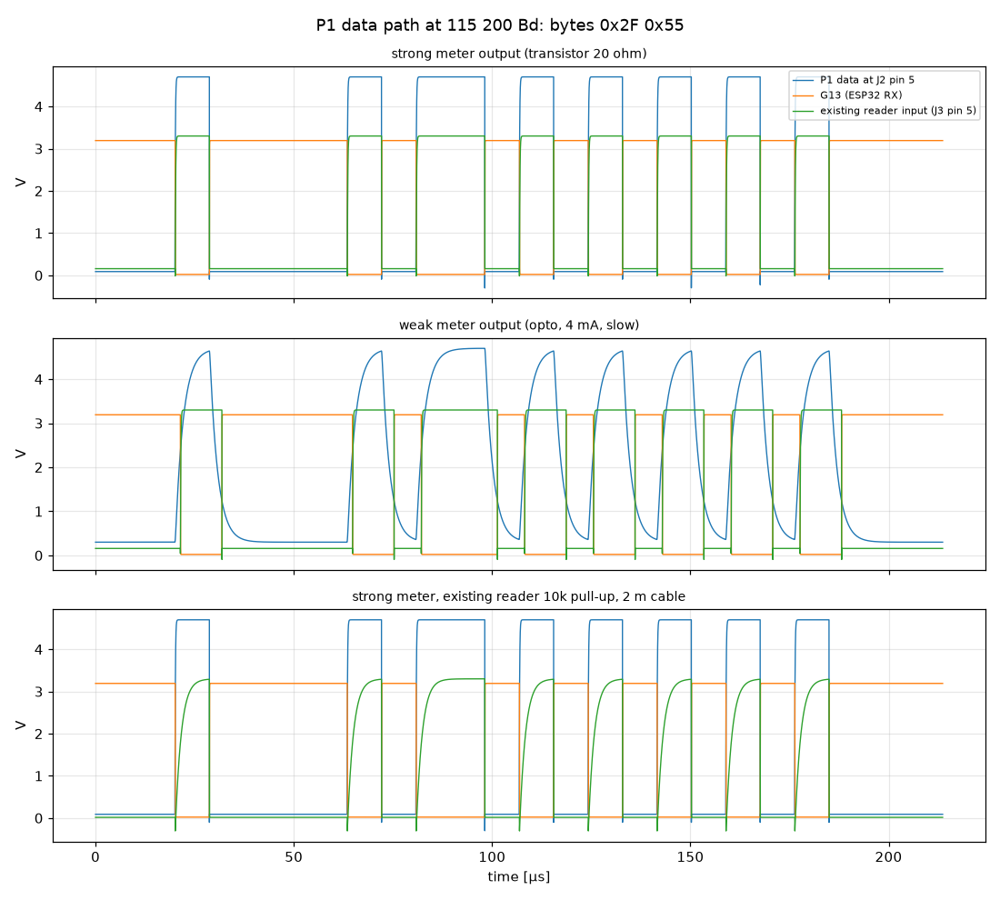
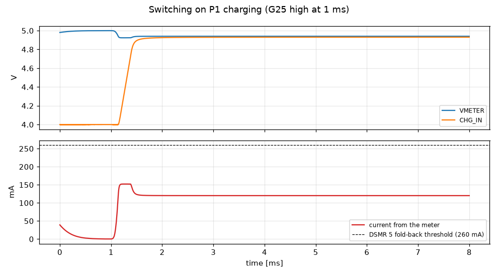

# Simulation results

Generated by `tools/sim/run_sims.py` with ngspice (KiCad 10). Generic models: check levels and margins, not exact waveforms.

## 1. Data path at 115 200 Bd

| Case | Lowest level at J2 pin 5 [V] | G13 high [V] | Max bit-width error G13 [%] | Max bit-width error reader [%] |
|---|---:|---:|---:|---:|
| strong meter output (transistor 20 ohm) | -0.30 | 3.19 | 0.55 | 1.48 |
| weak meter output (opto, 4 mA, slow) | 0.30 | 3.19 | 21.2 | 20.18 |
| strong meter, existing reader 10k pull-up, 2 m cable | -0.30 | 3.19 | 0.54 | 14.26 |

## 2. Data request levels (DC)

DSMR: the request must be ≥ 4.0 V to make the meter send.

| Case | Request at meter (J2 pin 2) [V] | G34 [V] | G36 [V] |
|---|---:|---:|---:|
| DSMR 5, CoreInk requests (G26 high) | 4.67 | 0.00 | 2.02 |
| DSMR 5, existing reader requests | 4.67 | 2.87 | 2.02 |
| DSMR 5, both request | 4.67 | 2.87 | 2.02 |
| DSMR 5, nobody requests | 0.00 | 0.00 | 2.02 |
| DSMR 2/3, CoreInk on, requests | 4.65 | 0.00 | 0.00 |
| DSMR 2/3, CoreInk off, reader requests | 3.20 | 2.03 | 0.00 |
| DSMR 5, reader requests with weak 4.5 V output (1 k) | 4.67 | 2.61 | 2.02 |

## 3. Switching on P1 charging

Peak current drawn from the meter: **152 mA** (DSMR 5 fold-back starts at 260 mA; the steady state is the 120 mA charge current plus the rest of the board).

## 4. Crossed (1-to-6) cable

Meter powered, cable crossed, CoreInk on battery.

| Node | Value |
|---|---:|
| vmeter | 0.033 |
| metreq | -4.990 |
| p1data | 3.071 |
| g36 | 0.014 |
| extreq | -4.913 |
| I_meter_mA | 1.774 |
