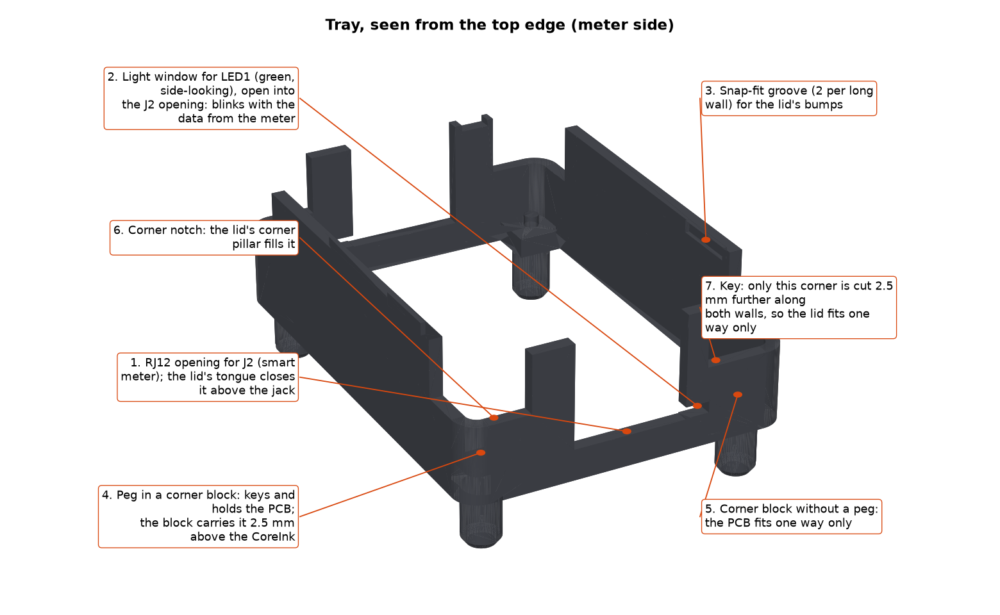
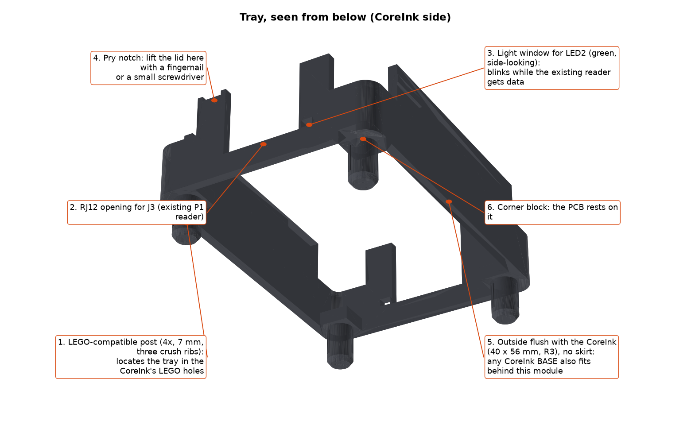
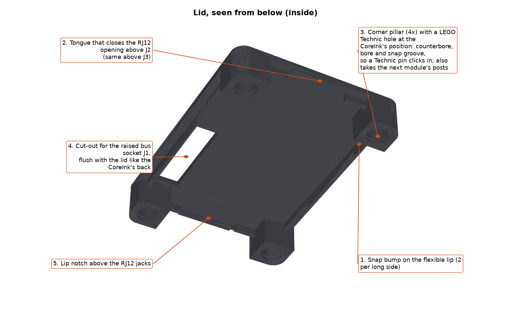
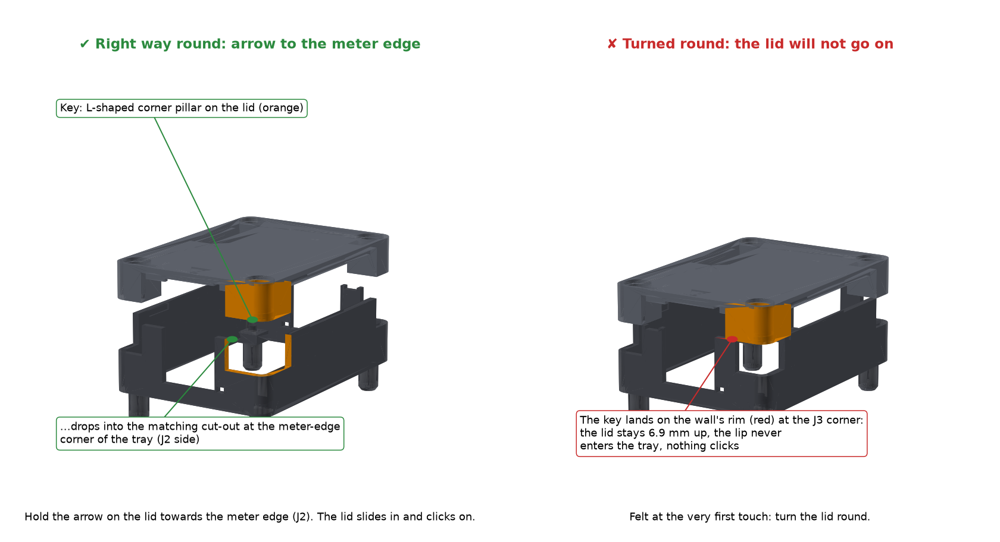

# P1-BASE v3 enclosure (*kuip*)

Two printed parts:

| File | Part |
|---|---|
| `fabrication/p1-base-kuip.step` / `.stl` | tray: holds the PCB on four corner blocks, LEGO posts underneath; a light window for each LED, running into its RJ12 opening |
| `fabrication/p1-base-lid.step` / `.stl` | lid that clicks onto the tray: the module's back, with tongues that close the RJ12 openings and corner pillars with LEGO Technic holes |

`kuip.py` is the parametric source (CadQuery 2.x): `python enclosure/kuip.py`. It reads the LED and jack positions from `pcb_features.json`, which `tools/gen_pcb.py` writes. `p1-base-v3-pcb.step` is the populated board, for checking the fit in a CAD program. `callouts.py` renders the parts with numbered callouts (`docs/images/enclosure-*-callouts.png`) and the lid keying picture for the manual (`docs/images/enclosure-lid-keying.png`).

| Tray, top edge | Tray, underside | Lid, inside |
|---|---|---|
|  |  |  |

How it works (frame: back of the CoreInk, HAT edge up):

* **The outside is exactly the CoreInk outline** (40 × 56 mm, corner radius 3) and there is no skirt: every module's back equals the CoreInk's back, so any BASE that fits a bare CoreInk also fits behind a P1-BASE. The walls (1.6 mm) are inside that outline; the PCB is 36.3 × 52.3 mm.
* The module stands on four corner blocks on the CoreInk's back; four **LEGO posts** (7 mm, with crush ribs) go into the CoreInk's four LEGO-compatible holes. They are longer than the 6 mm bus pins, so they guide the module before the pins engage and protect the pins in transport. The posts and the 16 bus contacts hold the module; a cable hanging from an RJ12 jack pulls across the posts rather than along them.
* The **lid repeats the CoreInk's back**: four LEGO holes at the same positions and a cut-out for the raised bus socket. Each hole is a **LEGO Technic hole** in a corner pillar of the lid: a counterbore at the entry and a snap groove one Technic module (7.8 mm) deep, so a real Technic pin clicks in as on the CoreInk (LEGO standard values, verify on a print). The tray's walls are notched at the corners for these pillars.
* The PCB rests on the corner blocks, 2.5 mm above the CoreInk, and is keyed by **three pegs**; the top-left corner has none, so the PCB fits one way only.
* An arrow on the lid's outside points to the meter edge.
* **The lid fits one way only.** Its top-left corner pillar (meter edge) is an L, 2.5 mm longer along both walls, and only that corner of the tray is cut away that far. Turned round, the L lands on the full-height wall at the J3 corner at the very first touch: the lid stays 6.9 mm up, its lip never enters the tray and nothing clicks. The key is part of the pillar over its full height, not a tab that can break off. `tools/checks/check_3d_fit.py` checks this stand-off on the solids.

  
* Two green **side-looking LEDs**, one beside each RJ12 socket, shine through a window in the wall next to the plug (the window runs into the jack opening, so no thin web stays between them): LED1 in the top (meter-side) wall left of J2, LED2 in the bottom wall right of J3 (seen from the back). They stay visible with a module behind the P1-BASE.
* The **lid clicks on**: a 1 mm lip inside the walls with two half-round bumps on each long side snaps into grooves in the long walls. The lip is 2.4 mm high and the bumps sit 1.6 mm below the rim, so 0.85 mm of wall stays above each groove to hold the lid down (with the bumps halfway down a 1.8 mm lip this was 0.15 mm, flagged by JLC3DP). To open it, lift it at the notch in the bottom wall (left of the J3 opening, seen from the back). The tray's corner notches are 0.2 mm larger than the lid's pillars.
* **The lid holds the PCB down**: under three corner pillars (not the key corner, where R7 sits) a round foot ends 0.1 mm above the PCB, so pushing the module on by its lid presses on the PCB, and a module pulled off J1 lifts the PCB only 0.1 mm. The snap fit then carries the pull-off force; for the prototype there are two lids, `p1-base-lid` (bump 0.35 mm) and `p1-base-lid-snap050` (0.5 mm), to compare.
* **J1 sits 0.3 mm below the lid's surface** (`LID_RAISE`), so with print and soldering tolerances the socket never stands proud and the next module rests on the lid; its 6.0 mm pins then go 5.7 mm into J1, inside Samtec's insertion range (3.68 to 6.35 mm). The lid's cut-out leaves 0.4 mm around J1's body (4.95 x 20.83 mm).

Values to verify on the first print (see `kuip.py`): RJ12 jack height (`JACK_H`), the snap fit (`SNAP_P`, `GROOVE_D`), the LED lens height (`LED_LENS_Z`), the length of the stacking-header pins against `GAP`, and the Technic hole (`TECH_*`) with a real LEGO Technic pin.

Print: MJF PA12 (as ordered for the prototype) or SLA resin need no special orientation. On an FDM printer: PETG, 0.2 mm layers; tray with its top rim on the bed (LEGO posts pointing up) and supports under the corner blocks; lid with its flat side on the bed.
